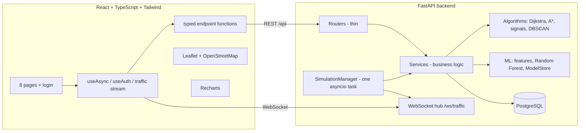

# FlowSense — AI-Powered City Traffic Intelligence and Optimization Platform

> **Data notice:** every traffic number in FlowSense comes from a built-in Python traffic **simulator** running on a
> **fictional road network**. Nothing is real-world live traffic. The API labels every response `"data_source": "simulated"`
> and the UI shows a "Simulated data" banner on every data page.

FlowSense monitors road conditions, predicts congestion, optimises traffic-signal timing, plans emergency-vehicle routes,
finds historical accident hotspots and manages incidents and road closures, through a FastAPI backend and a React dashboard.

## Problem statement

Traffic operations teams need a single interface for monitoring congestion, forecasting road conditions, understanding
historical accident patterns, reporting incidents and evaluating signal and route changes. FlowSense provides a local,
database-backed demonstration of those workflows using a clearly labelled fictional road network and simulated data.

## Objectives

- Demonstrate end-to-end monitoring of a simulated road network.
- Combine REST APIs, WebSocket updates and role-based operations in one application.
- Apply algorithms and machine learning to congestion, routing, signals and accident hotspots.
- Provide reproducible local setup, testing and database migration workflows.

## Build status (read this first)

| Part | Status | How it was verified |
|---|---|---|
| Backend API (FastAPI, 35 endpoints + WebSocket) | **Done** | 131 automated tests; real PostgreSQL 16 + real Uvicorn + real WebSocket client |
| PostgreSQL schema + Alembic migration | **Done** | upgrade, `alembic check` (no drift), downgrade/upgrade round trip on PostgreSQL 16 |
| Seed data, simulator, dataset generator | **Done** | tests + manual runs (`--reset` twice) |
| ML pipeline (Random Forest) with baselines | **Done** | tests; metrics below were produced by `python -m app.ml.train` |
| Python traffic simulation + WebSocket stream | **Done** | lifecycle/cleanup/streaming tests + integration test |
| React frontend (landing page, 8 pages + login, Leaflet maps, Recharts) | **Done; landing page checked in a real browser** | strict TypeScript, 166 unit/component tests, production build, Vite dev proxy for REST + WebSocket, 7 integration tests against the real backend; landing page and every existing page loaded in headless Chromium against the live backend (see the caveat below for what that did *not* cover) |
| Frontend ↔ backend contract | **Done** | TypeScript types are *generated* from the backend's OpenAPI document; checked to be in sync |
| Pinned `requirements.txt` / `package-lock.json` | **Done** | fresh virtualenv install → all backend tests pass |
| Docker Compose / Dockerfile | **Verified locally** | Docker Compose PostgreSQL and backend containers were built and started |
| Windows PowerShell commands below | **Verified on Windows** | Phase 2 setup and test commands were executed in Windows PowerShell |
| Optional SUMO + TraCI integration | **Not built yet** | planned |
| Vercel / Render deployment | **Not performed** | instructions below are untested |

**Important caveat about the UI:** the landing page was checked in headless Chromium at 1440, 1280, 1024, 768, 390 and 360 px
(no horizontal overflow, no console errors, mouse, touch and reduced-motion behaviour exercised), and every existing page was loaded
once in the same browser against the live backend. That is *not* the same as a design review on real devices. **Not verified:** the
OpenStreetMap map tiles (they need internet access, which the build sandbox did not have), the visual polish of the existing in-app
pages, Safari and Firefox, and any real phone. Run it, look at every page, and expect to polish some things.

## Features

| Module | What it does |
|---|---|
| 1 Traffic monitoring | 28 roads / 16 intersections; vehicle count, speed, density, 4 congestion levels, history; sortable/filterable table + map |
| 2 Congestion prediction | Random Forest, 30 min ahead, MAE/RMSE/R² vs two baselines, chronological split, feature importance, graceful when untrained |
| 3 Signal optimisation | Rule-based adaptive green allocation (min/max limits) + **measured** fixed-vs-adaptive comparison with queue chart |
| 4 Emergency routing | Dijkstra + A\*, traffic-adjusted weights, closures, fastest-vs-shortest, alternative route, automatic re-plan after a closure |
| 5 Accident hotspots | DBSCAN on 700 simulated accident records, severity-weighted ranking, period/severity filters, tunable radius |
| 6 Analytics dashboard | KPIs, trends, hourly pattern vs last week, congestion distribution, forecast, incidents, routing and signal summaries |
| 7 Incidents | Report, verify, resolve; close roads; role-based permissions; closures trigger route recalculation |
| Simulation | Start/stop from the UI, fixed or adaptive signals, live updates over WebSocket (with REST polling fallback) |

## Front door (landing page)

`/` is a public landing page; the working app lives under it.

| Route | What you get |
|---|---|
| `/` | Landing page for visitors. **Signed-in users are sent straight to `/dashboard`** (this also covers the redirect after signing in). |
| `/welcome` | The landing page for everyone, including signed-in users (linked from the sidebar as "Project overview"). |
| `/dashboard` | The dashboard (it used to live at `/`). Every other page keeps its path. |

How the hero works (`frontend/src/components/RevealLayer.tsx`): two registered images, the street at dusk and the same streets as FlowSense
reads them. A soft circular mask follows the cursor and reveals the second one. The mask bitmap is painted once on a canvas and only its
*position* changes per frame; pointer tracking uses refs and a `requestAnimationFrame` loop with frame-rate-independent smoothing, React never
re-renders while it moves, and the loop stops itself when nothing is moving. Touch screens get a lens that drifts on its own and follows a
finger; a real mouse always takes over from the drift. With `prefers-reduced-motion` the lens rests still on a junction and the push-in zoom is off.

Everything below the hero reads the real API (live network summary, forecast scores); nothing on the page is hard-coded data. The artwork is
generated from the simulated network, see `docs/hero-art/README.md`. Fonts (Inter and Playfair Display italic) are self-hosted through
`@fontsource` packages, so the page makes no third-party font requests.

## Architecture



Backend layers: `api/` (HTTP only) → `services/` (logic + DB) → `algorithms/` (pure functions).
Frontend layers: `pages/` → `hooks/` + `components/` → `services/endpoints.ts` (the only place that calls the API).
More: [docs/ARCHITECTURE.md](docs/ARCHITECTURE.md), [docs/ALGORITHMS.md](docs/ALGORITHMS.md) (input/output/complexity of every algorithm).

## Technology

Backend: Python 3.12 · FastAPI · SQLAlchemy 2 · Alembic · PostgreSQL 16 (psycopg 3) · Pydantic v2 · PyJWT · Argon2 ·
scikit-learn · pandas · NumPy · joblib · Matplotlib · pytest.
Frontend: React 18 · TypeScript 5 (strict) · Vite 6 · Tailwind CSS 3 · React Router 6 · Axios · Leaflet + react-leaflet ·
Recharts 3 · Lucide icons · Vitest + Testing Library.

## Local setup on Windows (PowerShell)

### One-command local startup

From the project root, the existing Windows startup script starts PostgreSQL, applies Alembic migrations, and opens the backend and frontend in separate PowerShell windows:

```powershell
.\start-local.ps1
```

The script uses the existing `.env` and Docker volume. It does not recreate the database or remove data.

Prerequisites: Python 3.12, Node.js 20+ (22 was used), Git, and either Docker Desktop **or** PostgreSQL 16.

```powershell
# 1. Backend: virtual environment and dependencies
cd FlowSense\backend
py -3.12 -m venv .venv
.\.venv\Scripts\Activate.ps1          # if blocked:  Set-ExecutionPolicy -Scope CurrentUser RemoteSigned
python -m pip install --upgrade pip
pip install -r requirements-dev.txt

# 2. Configuration
cd ..
Copy-Item .env.example .env
python -c "import secrets; print(secrets.token_urlsafe(48))"      # paste the output as SECRET_KEY in .env
# also set POSTGRES_PASSWORD, the same password inside DATABASE_URL, and SEED_DEFAULT_PASSWORD (demo accounts)

# 3. PostgreSQL - choose ONE
docker compose up -d db                                           # A) Docker
# B) native install: open "SQL Shell (psql)" and run:
#    CREATE ROLE flowsense LOGIN PASSWORD 'your-password';
#    CREATE DATABASE flowsense OWNER flowsense;

# 4. Create tables, load demo data
cd backend
alembic upgrade head
python -m app.seed                                                # prints the demo accounts

# 5. Generate the training dataset and train the model (about 1-2 minutes)
python -m app.simulation.generate_data --days 28
python -m app.ml.train                                            # prints MAE / RMSE / R2 vs baselines

# 6. Start the API (leave this window open)
uvicorn app.main:app --reload --port 8000
```

In a **second** PowerShell window:

```powershell
# 7. Frontend
cd FlowSense\frontend
npm ci                      # installs the exact versions in package-lock.json
npm run dev                 # http://localhost:5173  (proxies /api and /ws to the backend on :8000)
```

**Verify:** open <http://localhost:5173>. You land on the cinematic front page (move the cursor over the city to reveal the data layer); choose **Open the dashboard**. The dashboard should show KPI numbers, a map with coloured roads and a "Simulated data"
banner. Sign in as `operator@flowsense.demo` (password = your `SEED_DEFAULT_PASSWORD`), open *Traffic Monitoring*, press
**Start simulation** and watch the top-right chip turn to "● Live simulation" while road colours change. API docs: <http://localhost:8000/docs>.

```powershell
# Tests and production build
cd FlowSense\backend;  pytest                       # 131 tests, in-memory SQLite, no PostgreSQL needed
cd FlowSense\frontend; npm test                     # 166 tests
npm run build                                       # type-check + production bundle in dist/
# optional: test the frontend's API layer against the REAL running backend
$env:VITE_API_URL="http://localhost:8000"; $env:VITE_DEMO_PASSWORD="<your SEED_DEFAULT_PASSWORD>"; npm run test:integration
```

If you change the API, regenerate the contract and types: `python backend\scripts\export_openapi.py` then, in `frontend`, `npm run gen:api`.
Test fixtures are real API responses; refresh them with `backend\scripts\capture_frontend_fixtures.py` (API running on a freshly seeded database).

### Demo accounts and roles

| Role | Can do |
|---|---|
| anonymous | read everything: roads, live traffic, predictions, hotspots, incidents, analytics, WebSocket |
| `viewer` (self-registered accounts) | + report incidents, run and save predictions, run signal comparisons |
| `operator` | + update incidents, close roads, plan emergency routes, apply signal timing, start/stop simulation |
| `admin` | + list users and change roles (Settings page) |

### Docker Compose (not yet run by me)

```powershell
docker compose up --build            # db + api on :8000 (needs SECRET_KEY and POSTGRES_PASSWORD in .env)
docker compose exec backend python -m app.seed
docker compose exec backend python -m app.simulation.generate_data --days 28 --out /app/data/traffic_synthetic.csv
docker compose exec backend python -m app.ml.train
```
The compose file starts the database and API only; run the frontend with `npm run dev` as above.

## Screenshots

Add your own after running the app (suggested: dashboard, traffic monitoring, predictions, signal comparison, route planner, hotspot map, incidents):

| Page | File |
|---|---|
| Dashboard | `docs/screenshots/dashboard.png` *(placeholder)* |
| Emergency route planner | `docs/screenshots/emergency-route.png` *(placeholder)* |
| Accident hotspots | `docs/screenshots/hotspots.png` *(placeholder)* |

## API overview

Full contract: [`docs/openapi.json`](docs/openapi.json) (also served at `/openapi.json`).

| Area | Endpoints |
|---|---|
| Auth | `POST /api/auth/register` · `POST /api/auth/login` · `GET /api/auth/me` · admin: `GET /api/auth/users`, `PATCH /api/auth/users/{id}/role` |
| Network | `GET /api/roads` · `GET /api/intersections` |
| Traffic | `GET /api/traffic/live` · `GET /api/traffic/{road_id}` · `GET /api/traffic/history/{road_id}` |
| Predictions | `POST /api/predictions` · `GET /api/predictions/{road_id}` · `GET /api/predictions/overview` · `GET /api/predictions/model-info` |
| Signals | `GET /api/signals` · `GET /api/signals/{id}` · `POST /api/signals/optimize` · `POST /api/signals/{id}/reset` |
| Emergency | `GET /api/emergency-vehicles` · `POST /api/routes/emergency` · `GET /api/routes` · `GET /api/routes/{id}` · `POST /api/routes/{id}/recalculate` |
| Accidents | `GET /api/accidents` · `GET /api/accidents/hotspots` · `GET /api/accidents/analytics` |
| Incidents | `POST /api/incidents` · `GET /api/incidents` · `GET/PATCH /api/incidents/{id}` · `POST /api/incidents/{id}/close-road` |
| Analytics | `GET /api/analytics/overview` · `GET /api/analytics/traffic-trends` |
| Simulation | `POST /api/simulation/start` · `POST /api/simulation/stop` · `GET /api/simulation/status` · `WS /ws/traffic` |

Errors share one shape: `{"error": "<code>", "message": "..."}`; validation errors add `details` (and never echo submitted values such as passwords).

## Machine-learning workflow

1. `generate_data` runs the simulator headless for 28 days (15-minute records, random disruptions, 1.5 % sensor dropouts).
2. Cleaning (past-only fills) → 19 features → chronological 80/20 split with a purge gap.
3. Random Forest (100 trees) predicts density and speed 30 minutes ahead; evaluated against *persistence* and *historical-mean* baselines.
4. Model + metrics saved with joblib (`app/ml/artifacts/`, 9 MB) and plots to `docs/ml/`. Without a model the API answers `model_available: false` (and `503 model_not_trained` on `POST /api/predictions`) and the UI explains how to train it.

Test-set results (density in veh/km/lane, speed in km/h):

| Model | Density MAE | Density RMSE | Density R² | Speed MAE | Speed RMSE | Speed R² |
|---|---|---|---|---|---|---|
| **Random Forest** | **0.972** | **2.714** | **0.983** | **1.206** | **2.233** | **0.969** |
| Persistence baseline | 3.457 | 7.343 | 0.878 | 2.152 | 3.480 | 0.924 |
| Historical-mean baseline | 3.023 | 8.591 | 0.833 | 1.893 | 3.634 | 0.917 |

**Interpretation:** these scores are high because the simulator's demand is a smooth daily curve with ~8 % noise, so near-future traffic is
inherently predictable. They show the pipeline is sound and beats naive baselines **on simulated data**; they are *not* a claim about real traffic.

## Signal optimisation results (measured)

`python -m app.simulation.benchmark_signals` — 10 seeds, one simulated hour, identical arrivals for both strategies:

| Scenario | Fixed wait | Adaptive wait | Change |
|---|---|---|---|
| balanced demand | 21.2 s | 21.6 s | +1.9 % (no real difference) |
| north-south heavy | 48.6 s | 18.8 s | −61.4 % |
| demand shifts mid-hour | 44.6 s | 18.3 s | −59.1 % |

Adaptive control helps when demand is unbalanced or changes; it gains nothing under balanced demand. Simplified two-phase model, not field data.

## Testing

* **Backend, 129 tests (~25 s):** algorithm correctness (known graphs, closures, bounds, determinism), ML (cleaning without leakage,
  split, metrics, missing/corrupt model), every API area incl. role checks, simulation start/stop/cleanup, WebSocket streaming and origin check, database constraints, seed/reset.
* **Frontend, 166 tests (~12 s):** formatters, API client (token header, 401 handling, error messages), `useAsync` (stale responses, polling, cleanup),
  WebSocket hook (reconnect/backoff/teardown), shared UI states (loading / error+retry / empty), role gating, layout and navigation, login, and every page's
  main flows, the landing page (content, real links, live-data panels in all four states, mobile menu), the front-door routing rules, and the cursor-spotlight component (smoothing, mask painted once, mouse-over-drift, reduced motion, focal point, cleanup). Fixtures are **real API responses**, so the tests use the true contract. Charts are rendered with the real Recharts library.
* **Integration, 7 tests:** the frontend's typed API functions against the live backend, including login, role refusal, routing with a closure and re-route, simulation and the WebSocket.
* The build found and fixed real bugs along the way (e.g. WebSocket snapshot not JSON-serialisable, unstable prediction order, `--reset` leaving demo users behind and a half-seeded database).

## Deployment (planned, not yet performed)

* **Backend on Render:** build `pip install -r backend/requirements.txt`; start `cd backend && alembic upgrade head && uvicorn app.main:app --host 0.0.0.0 --port $PORT`.
  Set `ENVIRONMENT=production`, a fresh `SECRET_KEY`, `CORS_ORIGINS=https://<your-vercel-app>`, and `DATABASE_URL`
  (Render shows `postgres://…`; change the prefix to `postgresql+psycopg://`). Local `.env` values do **not** carry over.
  The 9 MB model is git-ignored: remove it from `.gitignore` and commit it, or run the generate/train commands once in the Render shell. Then run `python -m app.seed`.
  Free instances sleep when idle, which also stops the live simulation; start it again from the UI.
* **Frontend on Vercel:** import the repo, set *Root Directory* = `frontend`, framework = Vite, and the environment variable
  `VITE_API_URL=https://<your-render-service>` (no trailing slash). `frontend/vercel.json` already contains the single-page-app rewrite.
  The WebSocket URL is derived from `VITE_API_URL` (`https` → `wss`). Add the Vercel URL to the backend's `CORS_ORIGINS` (it is also the WebSocket origin allow-list).

## Troubleshooting

| Symptom | Fix |
|---|---|
| `SECRET_KEY must be at least 32 characters` | generate one (command above) and put it in `.env` |
| `connection refused` / `OperationalError` | PostgreSQL is not running or `DATABASE_URL` is wrong |
| `relation "roads" does not exist` | run `alembic upgrade head` |
| `Database already contains a road network` | `python -m app.seed --reset` (removes demo accounts and city data; keeps accounts people registered) |
| UI says "Cannot reach the FlowSense API" | start the backend on port 8000; in production check `VITE_API_URL` and `CORS_ORIGINS` |
| Prediction page says the model is not trained | run the dataset + `python -m app.ml.train` steps |
| Map is grey with no streets | the browser needs internet access to `tile.openstreetmap.org` |
| `ModuleNotFoundError: app` | run backend commands from the `backend` folder |
| `Activate.ps1 cannot be loaded` | `Set-ExecutionPolicy -Scope CurrentUser RemoteSigned` |
| Server takes ~10 s to start | normal: pandas and scikit-learn are imported at startup |

## Limitations

* All traffic and accident data is simulated; the road network is fictional. Prediction quality on real data is unknown.
* The landing page was viewed in headless Chromium only; the in-app pages, map tiles, Safari/Firefox and real phones were not reviewed visually, so expect polish work. No accessibility audit was done (semantic HTML, labels and ARIA roles are used, and tested).
* Signal model: two phases, no turning movements, queues are estimated from road occupancy (no stop-line detectors).
* Macroscopic simulator: no individual vehicles. Emergency-vehicle speed-up factors are assumptions.
* Alternative routes use a penalty heuristic, not exact k-shortest paths.
* The live simulation runs inside the API process (single instance); the login rate limiter is in-memory.
* The sign-in token is stored in the browser's `localStorage` (simple, but readable by any script on the page; a production system would prefer httpOnly cookies).
* Hotspots are descriptive, not predictive. Joblib model files are pickles: only load files you created.
* No end-to-end browser tests (e.g. Playwright) yet.

## Roadmap

Look at every page in a browser and polish · SUMO/TraCI option · Playwright end-to-end tests · deployment to Render/Vercel ·
real open datasets · turning-movement signal model · multi-step forecasts.
