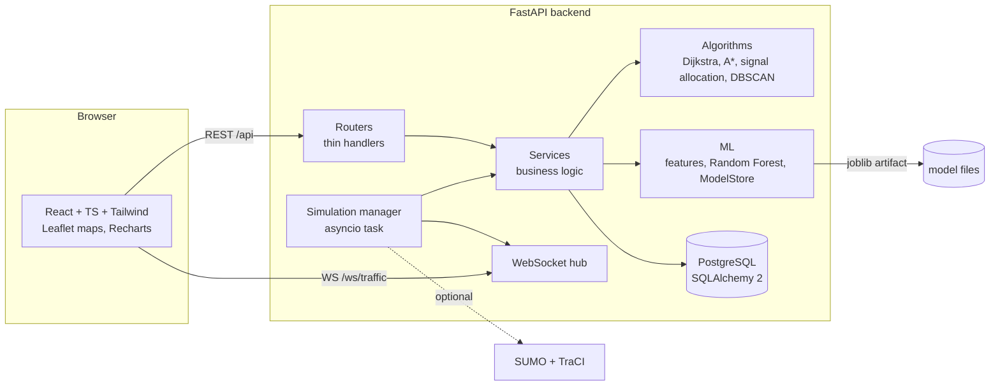
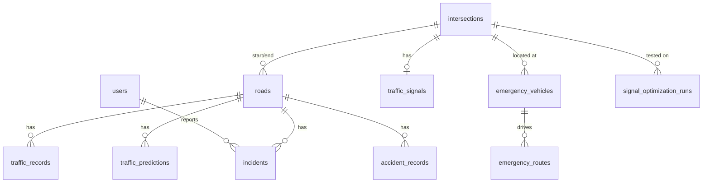

# FlowSense — Architecture (Phase A)

> All traffic data in FlowSense is **simulated** (produced by a Python macroscopic traffic simulator
> running on a fictional demo road network). Every API response that carries traffic data includes
> `"data_source": "simulated"`, and the UI must show that label.

## 1. System overview

**Layering rule:** `api/` (HTTP only) → `services/` (business logic, DB access) → `algorithms/` (pure
functions, no DB, no FastAPI). Pure algorithms are what the unit tests hit hardest.

## 2. Key design decisions (and why)

| Decision | Reason |
|---|---|
| Traffic congestion is classified from **occupancy = vehicles / jam capacity** | One number, easy to explain, matches Greenshields speed model (speed ratio ≈ 1 − occupancy) |
| Simulator is a **store-and-forward macroscopic model** | Runs fast in pure Python, conserves vehicles, produces realistic build-up/spillback. SUMO stays optional |
| Dataset for ML is generated by the **same simulator, headless** | Reproducible (fixed seed), no external download, consistent with live data |
| Time features describe the **target time** (t + horizon) | We are predicting the future, so the model must know *when* the future is |
| **Chronological split with purge gap** | Random splitting leaks future into training for time series |
| Reads are public, writes need a role (viewer < operator < admin) | Easy demos for recruiters, still demonstrates RBAC |
| Alternative routes via **penalty method** | Simple, explainable; no need for k-shortest-paths machinery |
| Signal comparison uses **identical pre-generated arrivals** for fixed and adaptive | The only honest way to compare strategies |
| Tests use in-memory SQLite, runtime uses PostgreSQL | Fast isolated tests; migrations are verified on PostgreSQL separately |

## 3. Data model

Deviations from the suggested schema (all improvements):
* `roads.start_node/end_node` → foreign keys `start_node_id/end_node_id` to `intersections`.
* `roads.length` → `length_m`; added `lanes`, `speed_limit_kmh`, `road_type`, `is_closed`.
* `traffic_signals.green_duration` → `ns_green_s` + `ew_green_s` (+ `cycle_s`, `mode`); the API exposes `green_duration` for the current phase.
* Added `traffic_records.congestion_level` and `data_source`; unique `(road_id, recorded_at)`.
* Added `signal_optimization_runs` (stores measured fixed-vs-adaptive results for the dashboard).
* `incidents.closes_road`, `emergency_routes.status` (`active/rerouted/completed`).

## 4. API contract (summary)

| Area | Endpoints | Auth |
|---|---|---|
| Auth | `POST /api/auth/register`, `POST /api/auth/login`, `GET /api/auth/me`, admin: `GET /api/auth/users`, `PATCH /api/auth/users/{id}/role` | public / user / admin |
| Network | `GET /api/roads`, `GET /api/intersections` | public |
| Traffic | `GET /api/traffic/live`, `GET /api/traffic/{road_id}`, `GET /api/traffic/history/{road_id}` | public |
| Predictions | `GET /api/predictions/overview`, `GET /api/predictions/model-info`, `GET /api/predictions/{road_id}`, `POST /api/predictions` | public / viewer+ |
| Signals | `GET /api/signals`, `GET /api/signals/{intersection_id}`, `POST /api/signals/optimize` (`apply=true` needs operator) | public / viewer+ |
| Emergency | `GET /api/emergency-vehicles`, `POST /api/routes/emergency`, `GET /api/routes`, `GET /api/routes/{id}`, `POST /api/routes/{id}/recalculate` | operator+ for POST |
| Accidents | `GET /api/accidents`, `GET /api/accidents/hotspots`, `GET /api/accidents/analytics` | public |
| Incidents | `POST /api/incidents` (viewer+), `GET /api/incidents`, `GET /api/incidents/{id}`, `PATCH /api/incidents/{id}` (operator+), `POST /api/incidents/{id}/close-road` (operator+) | mixed |
| Analytics | `GET /api/analytics/overview`, `GET /api/analytics/traffic-trends` | public |
| Simulation | `POST /api/simulation/start`, `POST /api/simulation/stop` (operator+), `GET /api/simulation/status` | mixed |
| Real-time | `WS /ws/traffic` | public (read-only) |

List endpoints that can grow return `{items, total, limit, offset}`.
The authoritative contract is the generated OpenAPI document at `/openapi.json`; the frontend types are
generated from it in Phase C so the two cannot drift apart.

## 5. Algorithms

| Algorithm | Input | Output | Time complexity | Purpose |
|---|---|---|---|---|
| Dijkstra | graph, source, target, objective | optimal path + cost | O((V+E) log V) | Exact fastest/shortest route |
| A* | same + haversine heuristic | same path, fewer expansions | O(E) best … O(b^d) worst; typically ≪ Dijkstra | Faster routing on geographic graphs |
| Penalty alternative | graph, primary route | second distinct route | 1–3 extra Dijkstra runs | "Alternative route" |
| Bounded green allocation | phase pressures, limits | green seconds per phase | O(p²), p = phases (2) | Adaptive signal timing within min/max |
| Intersection micro-simulation | approaches, strategy, seed | wait time, throughput, queue | O(T · a) | Measured fixed vs adaptive comparison |
| Store-and-forward step | network state | new vehicle counts | O(R) per tick | Traffic simulation |
| Random Forest regression | engineered features | density, speed 30 min ahead | O(n_trees · n log n) train | Congestion prediction |
| DBSCAN (haversine) | accident points | clusters | O(n log n) with ball tree | Hotspots (descriptive only) |

## 6. Technical risks

| Risk | Mitigation |
|---|---|
| ML looks good only because of leakage | chronological split + purge gap, two baselines, tests |
| Persistence baseline is strong at short horizons | report honestly; horizon default 30 min; README states the result as measured |
| Simulation task leaks / double-starts | single `SimulationManager`, `asyncio.Event` stop, lifespan shutdown, 409 on double start |
| SQLite vs PostgreSQL differences | portable SQL only (`GROUP BY recorded_at`, no `date_trunc`); migrations verified on PostgreSQL |
| `joblib` loads pickles | only load artifacts from the local trusted `MODEL_DIR` |
| SUMO not installable everywhere | optional module, auto-detected, Python simulator is the default |

## 7. Frontend decisions

| Decision | Reason |
|---|---|
| TypeScript types are **generated** from `docs/openapi.json` (`npm run gen:api`) | The frontend cannot drift from the backend contract; a mismatch becomes a compile error |
| Components never call axios; everything goes through `services/endpoints.ts` | One place to see and mock the API surface |
| One `useAsync` hook for loading / error / stale-response / polling | Every widget handles all four states (loading, error + retry, empty, data) the same way |
| One shared WebSocket (`TrafficStreamProvider`) with exponential-backoff reconnect | Fewer connections; the UI keeps working through REST polling when the socket is down |
| Pages are lazy-loaded | Leaflet and Recharts (~580 KB) are not part of the first download (~250 KB) |
| Dev server proxies `/api` and `/ws` | No CORS configuration needed locally |
| Tests use **real captured API responses** as fixtures | Tests exercise the true contract, not invented data |

## 8. Development checklist

Legend: ✅ done and verified · ◐ done, with a stated gap · ⬜ not started

| Phase | Status |
|---|---|
| A – architecture and planning | ✅ |
| B – backend (API, DB, ML, algorithms, simulation, WebSocket) | ✅ 129 tests; PostgreSQL + real server verified |
| C – frontend (8 pages + login, maps, charts) | ◐ built, type-checked, tested, bundled; **not viewed in a browser** |
| D – integration | ✅ 7 integration tests against the live backend; dev proxy (REST + WS) verified |
| E – testing and bug fixing | ✅ backend 129, frontend 121, integration 7; bugs found and fixed are listed in the README |
| F – delivery | ◐ README, `.env.example`, migrations, seed, Docker files, deploy notes done; Docker/Render/Vercel **not run**; SUMO **not built** |
